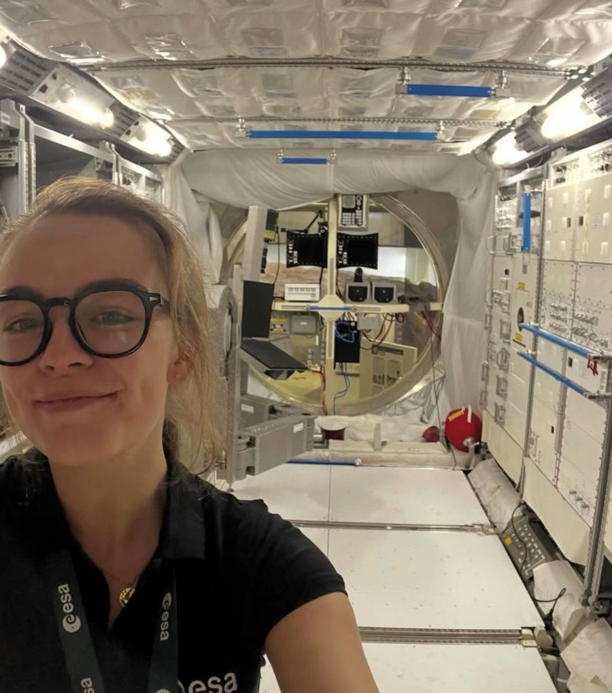
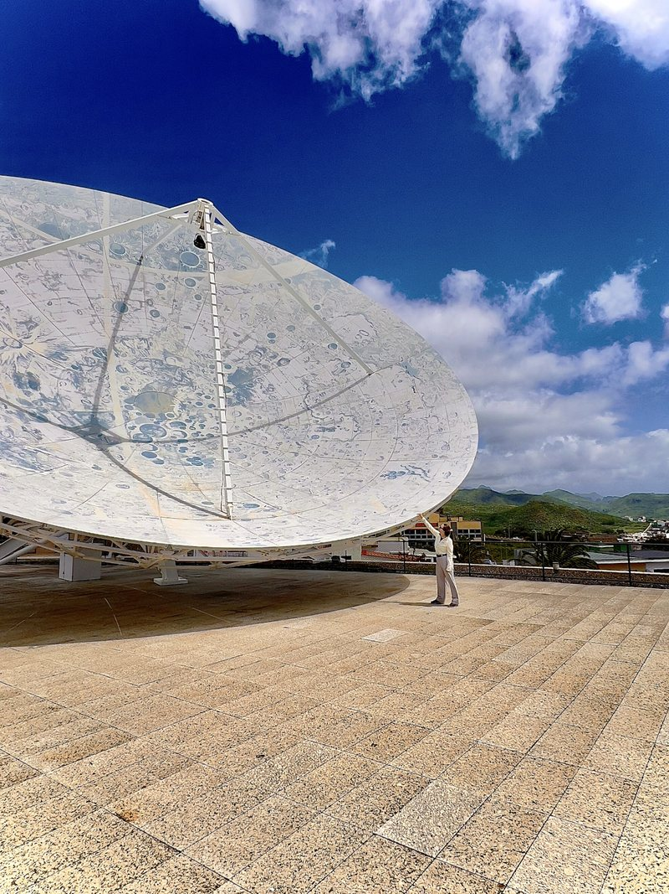
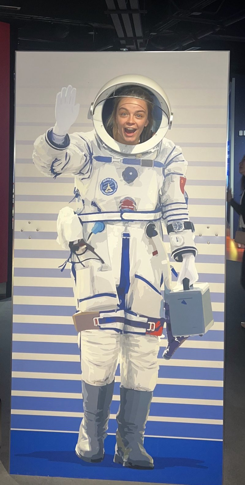
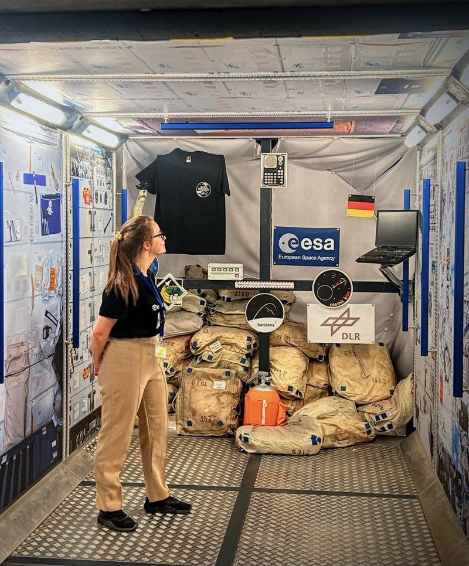

# About me

My interest in space goes back to my teens, when I volunteered with Astronomy Ireland, setting up and running telescopes at public stargazing nights. That led to a BSc in Physics with Astronomy at DCU and then an MSc in Space Science and Technology at UCD.

*Inside a space station module mockup during my ESA internship, 2026.*

Remote sensing caught my interest during the MSc, radar especially, because it works through cloud and at night and there is still a lot to work out about what it can see. At ESTEC most of my days involved writing Python, reading papers, and trying to understand why a number looked wrong. Sometimes it was the physics and sometimes it was the file format.

I like work where science and engineering meet, and I like explaining things. I've tutored physics and maths for a few years, coached children at my local GAA club, and helped school teams with their CanSat projects.

## Outside work

From 2016 to 2019 I coached at Blessington GAA, first with the children in the club academy and then goalkeeper training for the under-12 girls. I went to an all-Irish secondary school, Coláiste Íosagáin, and I also tutor Irish.

*Is féidir liom obair trí Ghaeilge freisin.* (I can work through Irish too.)

## A few more photos

*Click a photo to see it full size.*

## Skills

My skills, and the projects where I used them, are on the [skills page](skills.html).
