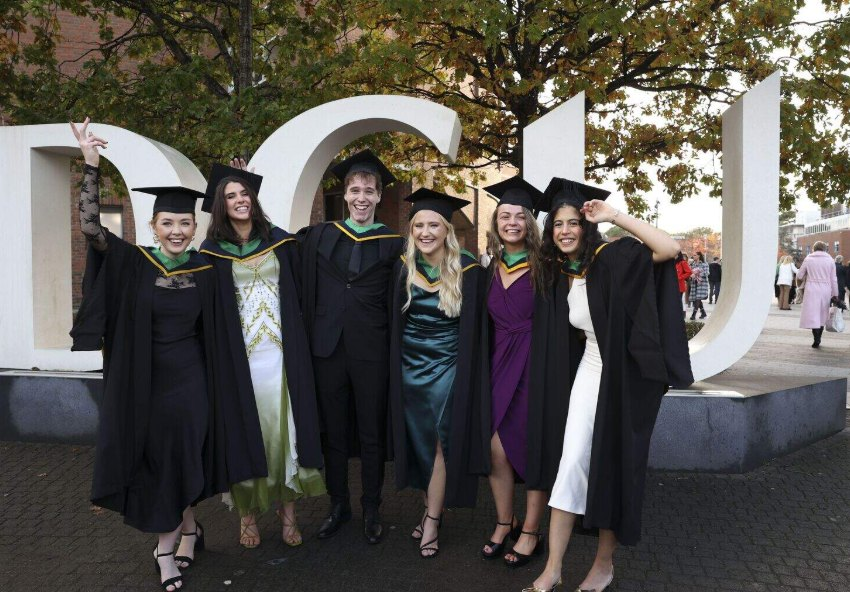

# Education

### MSc Space Science and Technology
*University College Dublin, 2025 to 2026*

First Class Honours.

Thesis on sea surface salinity retrieval from Biomass P-band SAR, carried out at ESA ESTEC: [report (PDF)](files/Doyle_ESA_Biomass_Internship_Report_2026.pdf) and [poster (PDF)](files/Doyle_Biomass_Internship_Poster_2026.pdf). Modules included SAR and InSAR remote sensing, satellite subsystems, spacecraft operations and space mission design.

### BSc Physics with Astronomy
*Dublin City University, 2019 to 2023*

Second Class Honours, Grade 1 (2.1). Final year thesis on orbital modelling and launch windows to Jupiter and the outer planets: [thesis (PDF)](files/Doyle_BSc_Thesis_Jupiter_Launch_Windows_2023.pdf).

*Graduation day at DCU, featured in the Irish Independent. Photo: Kyran O'Brien, DCU Communications Office.*

### Leaving Certificate
*Coláiste Íosagáin, graduated 2019*

510 CAO points. Coláiste Íosagáin is an all-Irish secondary school, and all subjects were taken through Irish.

Subjects: Irish, English, Biology, Geography, Economics and French at Higher Level, and Mathematics at Ordinary Level. Chemistry and Applied Mathematics were also taken as additional subjects.

A full list of modules, with a summary of each, is on the [transcript page](transcript.html). Licences and certificates are listed on the [certificates page](certificates.html).
