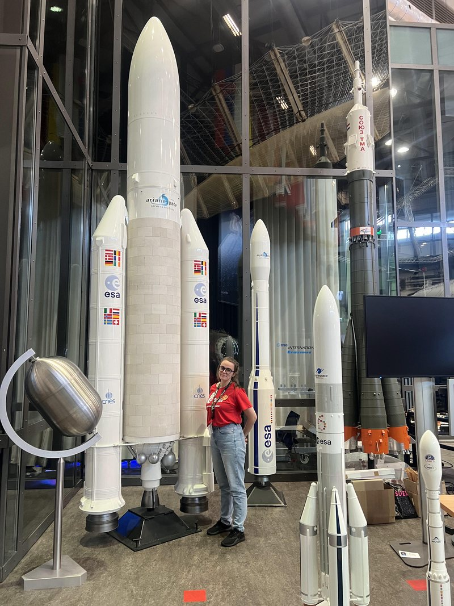

# Experience

### Earth Observation Intern, Biomass mission
*European Space Agency, ESTEC, Noordwijk. May to October 2026*

- Built and validated a sea surface salinity retrieval pipeline for P-band SAR
- Wrote a scanner that catalogued every location Biomass has imaged
- Found a band order mismatch that was corrupting polarisation data
- Prepared cal/val site files for my supervisor's team
- Science and CAD work on the YPSat-2 payload

*With the model launchers during my ESA internship, 2026.*

### Tutor, Grade+
*My own tutoring practice. February 2024 to now*

Physics and maths from late primary up to undergraduate level. I also tutor Irish.

### Lab technician and tutor
*School of Physics, DCU. During my BSc*

Helped run undergraduate physics labs and tutorials.
