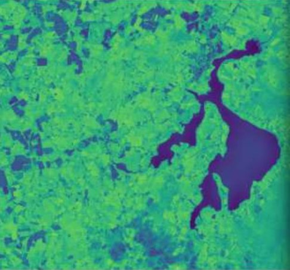
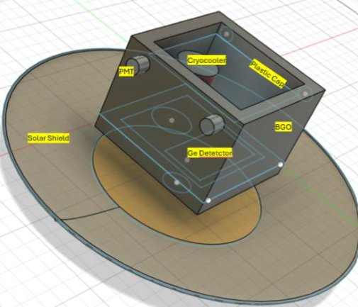
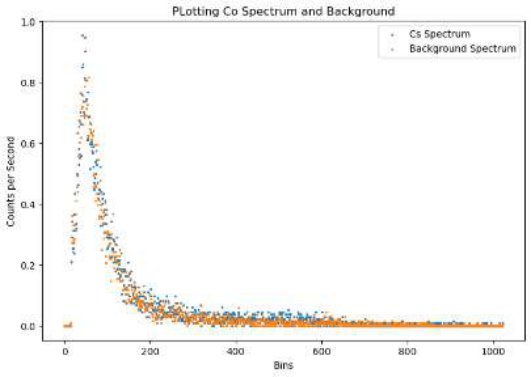
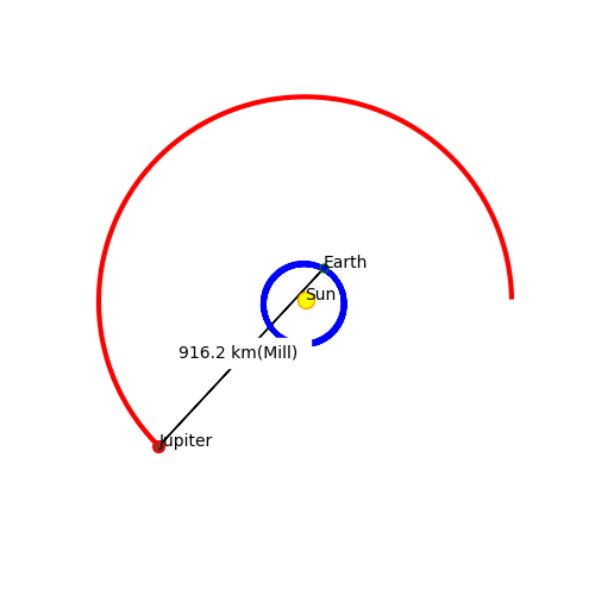
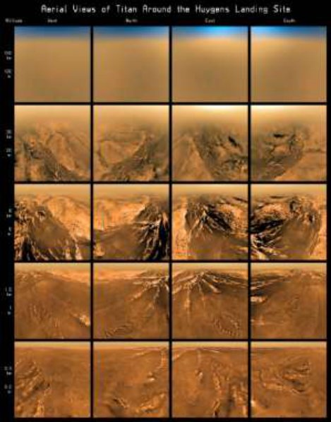

# Projects

A selection of research, engineering and coursework projects. Code from my ESA work is on [GitHub](https://github.com/orlaithdoyle/Biomass_ocean), and full reports are attached as PDFs where available.

Jump to: <a href="#earth-observation-and-radar">Earth observation and radar</a> &nbsp;|&nbsp; <a href="#spacecraft-and-missions">Spacecraft and missions</a> &nbsp;|&nbsp; <a href="#physics-astronomy-and-planetary-science">Physics, astronomy and planetary science</a>

## Earth observation and radar

### Sea surface salinity from Biomass
*ESA ESTEC and MSc thesis, 2026*

Biomass is ESA's first P-band SAR mission. I developed a pipeline that takes its Level 1 products, uses the ratio of the HH and VV polarisations, corrects for wind-driven surface roughness using ERA5, and inverts a seawater dielectric model to estimate salinity. Each scene was validated against SMOS and the GLORYS12 ocean reanalysis. For the best scene, in the South Atlantic, the retrieval agreed with GLORYS12 to within 0.4 psu.

In the course of this work I identified that one product format stored its image bands in the reverse order to its own metadata, which had been silently swapping the HH and VV channels.

*Biomass HH-VV phase (left) against SMOS salinity along the same swath (middle) and the wider salinity field (right), Amazon mouth, July 2026.*

**Tools:** Python, xarray, tifffile, ESA MAAP, ERA5, SMOS, GLORYS12

**Read more:** [Internship report (PDF, 2.4 MB)](files/Doyle_ESA_Biomass_Internship_Report_2026.pdf)&nbsp;&nbsp;|&nbsp;&nbsp;[Poster (PDF, 3.3 MB)](files/Doyle_Biomass_Internship_Poster_2026.pdf)

### Mapping everywhere Biomass has looked
*ESA ESTEC, 2026*

A tool that scans the full Biomass catalogue (more than 220,000 products), identifies the roughly 5,000 unique locations imaged, and classifies each as ocean, coastal or land. It made selecting suitable ocean scenes far quicker. Because a full scan takes most of a day, it checkpoints its progress and resumes automatically after interruptions.

*Every Biomass swath available during my internship: ocean in blue, coast in red, land in green.*

**Tools:** Python, STAC API, ESA MAAP

### An ocean front in the Pacific
*ESA ESTEC, 2026*

One region of an equatorial Pacific scene stood out in the radar coherence and polarimetric analysis. Comparison with ocean model salinity and satellite sea surface temperature showed a tongue of fresher water and a temperature front at the same location, indicating a genuine ocean front rather than an artefact.

*Biomass coverage over the 2026 El Niño warm tongue, on a sea surface temperature anomaly map.*

**Tools:** Python, FFT cross-spectra, H/α polarimetric decomposition, GLORYS12, OSTIA

### HH-VV phase over the Amazon plume
*ESA ESTEC, 2026*

An analysis of the HH-VV phase difference off the mouth of the Amazon, examining its stability between repeat passes and comparing it with SMOS and SMAP salinity.

**Tools:** Python, SMOS, SMAP

### Blessington Lakes from space
*SAR and InSAR Remote Sensing module, UCD, 2026*

The Blessington Lakes supply over half of Dublin's drinking water. I used SWOT to track the reservoir's water level over the year, compared it with local rainfall and gauge records, and used Sentinel-2 to assess algal activity during low-water periods.

*Sentinel-2 vegetation index around the reservoir, August 2025.*

**Tools:** SWOT, Sentinel-2, Python, GIS

**Read more:** [Report (PDF, 1 MB)](files/Doyle_Blessington_Lakes_SWOT_Sentinel_Report_2026.pdf)&nbsp;&nbsp;|&nbsp;&nbsp;[Presentation slides (PDF, 3 MB)](files/Doyle_Blessington_Lakes_Slides_2026.pdf)

### Other coursework
*UCD, 2025 to 2026*

SAR analysis of the 2025 Myanmar earthquake; InSAR for volcanic deformation and peatland; ship detection with Sentinel-1; vegetation mapping with polarimetric SAR.

## Spacecraft and missions

### SQRT high-altitude balloon
*Satellite Subsystems module, UCD, 2025 to 2026*

I was project manager for SQRT, a five-person team that designed, built and flew a TupperSat payload on a stratospheric balloon launched from Armagh Observatory and Planetarium. The experiment was designed to release water into a vented chamber at around 35 mbar and observe its flash evaporation, as a small-scale analogue of the vapour plumes on icy moons such as Enceladus and Europa.

The payload lost power before reaching the trigger altitude, so the evaporation stage did not take place. Integration, launch, live telemetry, tracking and recovery were all successful. Using the recovered data, I reconstructed the pressure, temperature, ascent and descent profiles of the flight and compared the actual ground track with our prediction.

<figure><figcaption>The flight-ready SQRT payload.</figcaption></figure>
<figure><figcaption>Predicted path (blue) against the real ground track (red).</figcaption></figure>

**Tools:** Raspberry Pi Pico, MicroPython, Python, GPS telemetry, balloon trajectory prediction

**Read more:** [My flight analysis and reflection (PDF, 2.4 MB)](files/Doyle_SQRT_Flight_Analysis_and_Reflection_2026.pdf)

**Team documents** (co-written with Javier Ayuso, Caimin Keavney, Bruce Ritter and Elyana Abdallah):

- Preliminary Design Review: [Mission Description](files/sqrt/SQRT_PDR_Mission_Description.pdf), [Design Justification](files/sqrt/SQRT_PDR_Design_Justification.pdf), [Systems Engineering Plan](files/sqrt/SQRT_PDR_Systems_Engineering_Plan.pdf), [Project Management Plan](files/sqrt/SQRT_PDR_Project_Management_Plan.pdf)
- Critical Design Review: [Project Management Plan](files/sqrt/SQRT_CDR_Project_Management_Plan.pdf), [Systems Engineering Plan](files/sqrt/SQRT_CDR_Systems_Engineering_Plan.pdf), [Hardware Design](files/sqrt/SQRT_CDR_Hardware_Design.pdf), [Software Design](files/sqrt/SQRT_CDR_Software_Design.pdf), [Verification Plan](files/sqrt/SQRT_CDR_Verification_Plan.pdf), [Flight Test Plan](files/sqrt/SQRT_CDR_Flight_Test_Plan.pdf), [Data Management Plan](files/sqrt/SQRT_CDR_Data_Management_Plan.pdf)
- Flight Acceptance Review: [Operations and User Manual](files/sqrt/SQRT_Operations_and_User_Manual.pdf), [Review slides](files/sqrt/SQRT_Flight_Acceptance_Review_Slides.pdf)

### EIRSAT-1 mission test
*Spacecraft Operations module, UCD, 2026*

As part of the BETA crew, I carried out a mission test on the EIRSAT-1 FlatSat, the ground model of Ireland's first satellite. Over five radio passes the crew rotated through operational roles, including Test Support Operator and Daily Pass Planner, following the mission's operating procedures. We downlinked and decoded housekeeping and payload telemetry, and recovered the spacecraft in real time after a battery voltage drop sent it into safe mode.

*Counting down to a pass during the mission test, April 2026.*

**Read more:** [Mission test report (PDF, 4.1 MB)](files/Doyle_BETA_Mission_Test_Report_2026.pdf)

### TiNi: a gamma-ray mission concept
*Space Mission Design Skills module, UCD, 2026*

A mission concept to measure radioactive nickel and titanium produced in Type Ia supernovae. Two spacecraft fly in formation: one carries a Laue lens that focuses gamma rays onto a cooled germanium detector on the other. The report covers the science case, requirements, instrument design and spacecraft design.

*The detector spacecraft design, with its germanium detector, cryocooler and sunshield.*

**Read more:** [Mission design report (PDF, 0.7 MB)](files/Doyle_TiNi_Gamma-Ray_Mission_Design_2026.pdf)

### YPSat-2 valve mechanism
*ESA ESTEC, 2026*

Science justification and CAD design for a venous valve mechanism on ESA's young professionals satellite payload.

## Physics, astronomy and planetary science

### Comparing gamma-ray detectors
*Space Detector Laboratory, UCD, 2026*

A group laboratory study comparing CdTe, NaI(Tl) and BGO detectors using radioactive sources. We fitted photopeaks to calibrate each detector, measured energy resolution and efficiency, characterised the off-axis response, and assessed the suitability of each detector for different space instruments.

*Cobalt source spectrum plotted against the background measurement.*

**Tools:** Python, curve fitting, MAESTRO

**Read more:** [Lab report (PDF, 1.2 MB)](files/Doyle_Gamma-Ray_Detector_Comparison_2026.pdf)

### Launch windows to Jupiter and beyond
*BSc thesis, DCU, 2023*

Final year project: modelling planetary orbits in Python using NASA JPL ephemerides, and identifying optimal launch windows for transfer orbits from Earth to Jupiter and the outer planets.

*Earth and Jupiter positions from my orbit model, with their separation at a candidate launch date.*

**Tools:** Python, NASA JPL ephemerides, orbital mechanics

**Read more:** [Thesis (PDF, 1.5 MB)](files/Doyle_BSc_Thesis_Jupiter_Launch_Windows_2023.pdf)

### Titan and Earth: rivers and lakes
*Planetary Geomorphology module, UCD, 2026*

An essay comparing the rivers, lakes and deltas of Saturn's moon Titan with those on Earth, drawing on Cassini-Huygens data. The landforms are strikingly similar, despite being shaped by liquid methane over water ice, under very different gravity and temperature.

*Views of Titan's surface taken by the Huygens probe during its descent. Image: ESA/NASA/JPL/University of Arizona.*

**Read more:** [Essay (PDF, 0.7 MB)](files/Doyle_Titan_vs_Earth_Hydrology_2026.pdf)

