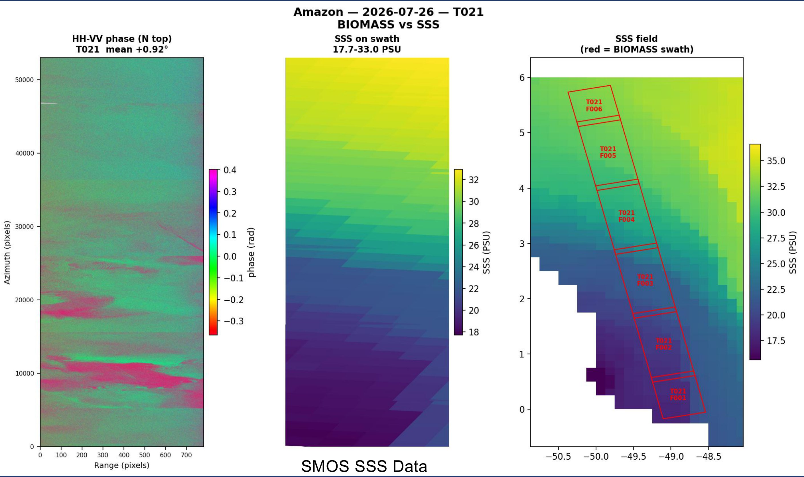
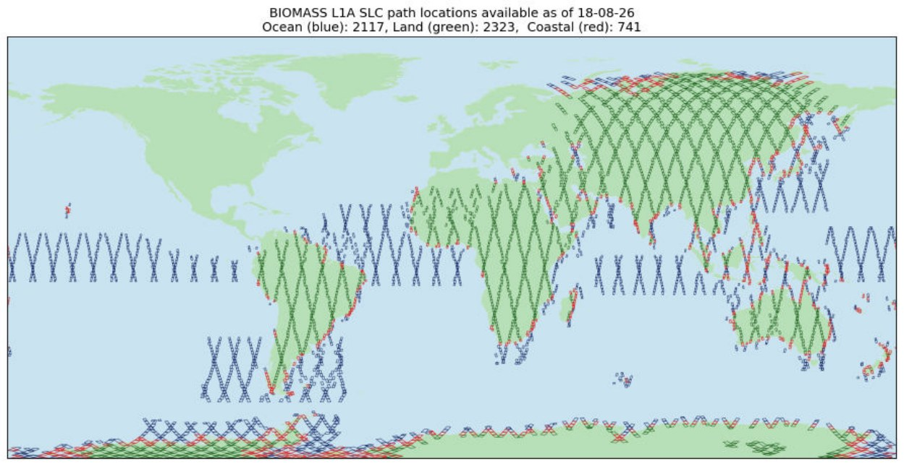
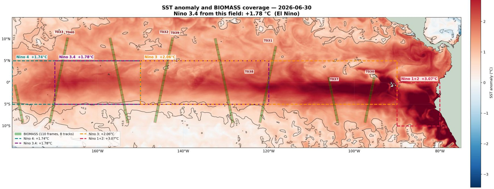
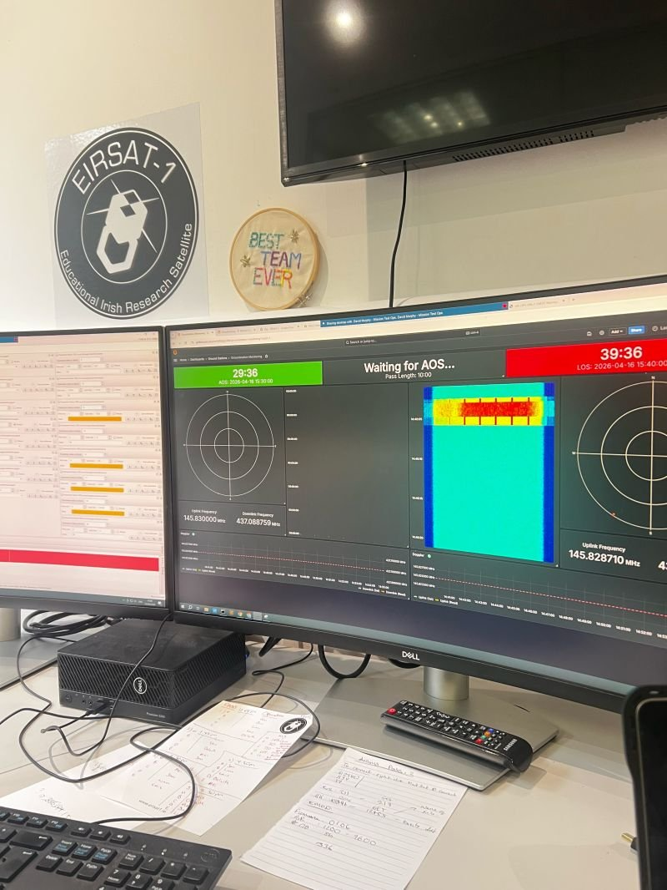
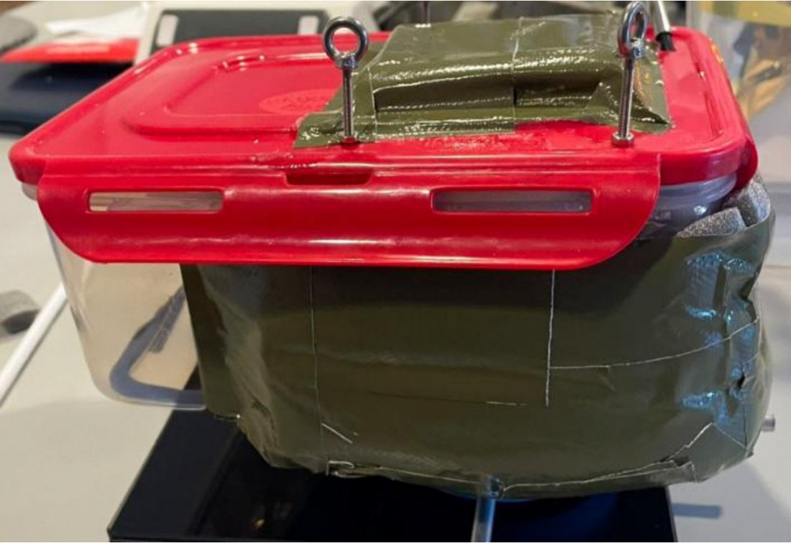
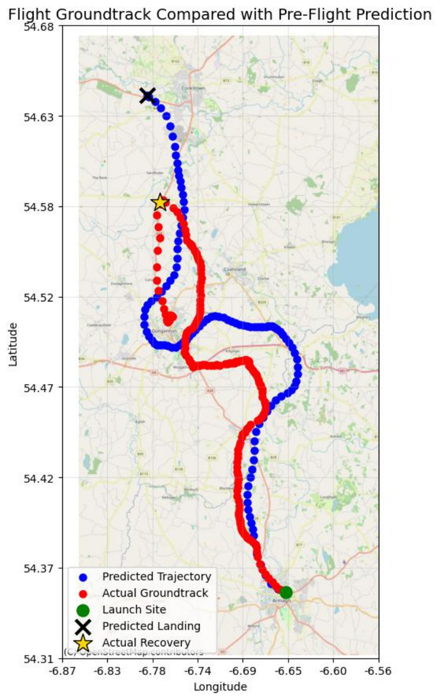

# Projects

Code for my ESA work is on [GitHub](https://github.com/orlaithdoyle/Biomass_ocean). Most projects below have the full report attached as a PDF.

### Sea surface salinity from Biomass
*ESA ESTEC and MSc thesis, 2026*

Biomass is ESA's first P-band radar satellite. I built a pipeline that takes its Level 1 products, compares the HH and VV polarisations, corrects for wind roughening of the sea surface using ERA5, and converts the result to salinity using a dielectric model of seawater. I checked each scene against the SMOS satellite and the GLORYS12 ocean model. For the best scene, in the South Atlantic, my estimate came within 0.4 psu of GLORYS12.

Along the way I found that one product format stored its image bands in the opposite order to its own metadata, which had been swapping HH and VV without anyone noticing.

*Biomass HH-VV phase (left) against SMOS salinity along the same swath (middle) and the wider salinity field (right), Amazon mouth, July 2026.*

**Tools:** Python, xarray, tifffile, ESA MAAP, ERA5, SMOS, GLORYS12

**Read more:** [Internship report (PDF, 2.4 MB)](files/Doyle_ESA_Biomass_Internship_Report_2026.pdf)&nbsp;&nbsp;|&nbsp;&nbsp;[Poster (PDF, 3.3 MB)](files/Doyle_Biomass_Internship_Poster_2026.pdf)

### Mapping everywhere Biomass has looked
*ESA ESTEC, 2026*

A script that works through the whole Biomass catalogue (over 220,000 products), finds the roughly 5,000 unique places imaged, and sorts them into ocean, coast and land. It made finding good ocean scenes much quicker. It can be stopped and restarted without losing progress, which mattered because a full run takes most of a day.

*Every Biomass swath available during my internship: ocean in blue, coast in red, land in green.*

**Tools:** Python, STAC API, ESA MAAP

### An ocean front in the Pacific
*ESA ESTEC, 2026*

One patch of an equatorial Pacific scene behaved differently in the radar data. When I compared it with ocean model salinity and satellite sea temperature, there was a tongue of fresher water and a temperature front in the same spot, so it looks like a real ocean front.

*Biomass coverage over the 2026 El Niño warm tongue, on a sea surface temperature anomaly map.*

**Tools:** Python, FFT cross-spectra, H/α polarimetric decomposition, GLORYS12, OSTIA

### HH-VV phase over the Amazon plume
*ESA ESTEC, 2026*

Looked at the phase difference between HH and VV radar returns off the mouth of the Amazon, how stable it was between repeat passes, and how it compared with SMOS and SMAP salinity.

**Tools:** Python, SMOS, SMAP

### YPSat-2 valve mechanism
*ESA ESTEC, 2026*

Science justification and CAD work for a vein valve mechanism on ESA's young professionals satellite payload.

### EIRSAT-1 mission test
*Spacecraft Operations module, UCD, 2026*

As part of the BETA crew, I ran a mission test on the EIRSAT-1 FlatSat, the ground copy of Ireland's first satellite. Over five radio passes we rotated through operations roles, including Test Support Operator and Daily Pass Planner, using the real operations procedures. We downlinked and decoded housekeeping and payload telemetry, and when the spacecraft dropped into safe mode after a battery voltage drop, we worked through the recovery live.

*Counting down to a pass during the mission test, April 2026.*

**Read more:** [Mission test report (PDF, 4.1 MB)](files/Doyle_BETA_Mission_Test_Report_2026.pdf)

### TiNi: a gamma-ray mission concept
*Space Mission Design Skills module, UCD, 2026*

A mission concept for measuring radioactive nickel and titanium from Type Ia supernovae. Two spacecraft fly in formation: one carries a Laue lens that focuses gamma rays onto a cooled germanium detector on the other. The report covers the science case, requirements, instrument design and spacecraft design.

**Read more:** [Mission design report (PDF, 0.7 MB)](files/Doyle_TiNi_Gamma-Ray_Mission_Design_2026.pdf)

### Comparing gamma-ray detectors
*Space Detector Laboratory, UCD, 2026*

A group lab comparing CdTe, NaI(Tl) and BGO detectors with radioactive sources. We fitted the photopeaks to calibrate each detector, measured energy resolution and efficiency, tested how the response changed off-axis, and looked at which detector suits which space instrument.

**Tools:** Python, curve fitting, MAESTRO

**Read more:** [Lab report (PDF, 1.2 MB)](files/Doyle_Gamma-Ray_Detector_Comparison_2026.pdf)

### Blessington Lakes from space
*SAR and InSAR Remote Sensing module, UCD, 2026*

The Blessington Lakes supply over half of Dublin's drinking water. I used SWOT to track the lake's water level through the year, compared it with local rainfall and gauge records, and used Sentinel-2 to look for signs of algae during low-water periods.

**Tools:** SWOT, Sentinel-2, Python, GIS

**Read more:** [Report (PDF, 1 MB)](files/Doyle_Blessington_Lakes_SWOT_Sentinel_Report_2026.pdf)&nbsp;&nbsp;|&nbsp;&nbsp;[Presentation slides (PDF, 3 MB)](files/Doyle_Blessington_Lakes_Slides_2026.pdf)

### Titan and Earth: rivers and lakes
*Planetary Geomorphology module, UCD, 2026*

An essay comparing the rivers, lakes and deltas on Saturn's moon Titan with those on Earth, using Cassini-Huygens data. The landforms look almost the same, but they are carved by liquid methane over water ice, under different gravity and temperature.

**Read more:** [Essay (PDF, 0.7 MB)](files/Doyle_Titan_vs_Earth_Hydrology_2026.pdf)

### SQRT high-altitude balloon
*Satellite Systems module, UCD, 2025 to 2026*

I was project manager for SQRT, a five-person team that designed, built and flew a TupperSat payload on a stratospheric balloon launched from Armagh Observatory and Planetarium. The experiment was meant to release water into a vented chamber at around 35 mbar and watch it flash-evaporate, as a small-scale look at the vapour plumes on icy moons like Enceladus and Europa.

The payload lost power before reaching the trigger altitude, so the evaporation itself didn't happen. Everything else worked: integration, launch, live telemetry, tracking and recovery. From the recovered data I rebuilt the flight's pressure, temperature, ascent and descent profiles and compared the real ground track with our prediction.

<figure><figcaption>The flight-ready SQRT payload.</figcaption></figure>
<figure><figcaption>Predicted path (blue) against the real ground track (red).</figcaption></figure>

**Tools:** Raspberry Pi Pico, MicroPython, Python, GPS telemetry, balloon trajectory prediction

**Read more:** [My flight analysis and reflection (PDF, 2.4 MB)](files/Doyle_SQRT_Flight_Analysis_and_Reflection_2026.pdf)

**Team documents** (co-written with Javier Ayuso, Caimin Keavney, Bruce Ritter and Elyana Abdallah):

- Preliminary Design Review: [Mission Description](files/sqrt/SQRT_PDR_Mission_Description.pdf), [Design Justification](files/sqrt/SQRT_PDR_Design_Justification.pdf), [Systems Engineering Plan](files/sqrt/SQRT_PDR_Systems_Engineering_Plan.pdf), [Project Management Plan](files/sqrt/SQRT_PDR_Project_Management_Plan.pdf)
- Critical Design Review: [Project Management Plan](files/sqrt/SQRT_CDR_Project_Management_Plan.pdf), [Systems Engineering Plan](files/sqrt/SQRT_CDR_Systems_Engineering_Plan.pdf), [Hardware Design](files/sqrt/SQRT_CDR_Hardware_Design.pdf), [Software Design](files/sqrt/SQRT_CDR_Software_Design.pdf), [Verification Plan](files/sqrt/SQRT_CDR_Verification_Plan.pdf), [Flight Test Plan](files/sqrt/SQRT_CDR_Flight_Test_Plan.pdf), [Data Management Plan](files/sqrt/SQRT_CDR_Data_Management_Plan.pdf)
- Flight Acceptance Review: [Operations and User Manual](files/sqrt/SQRT_Operations_and_User_Manual.pdf), [Review slides](files/sqrt/SQRT_Flight_Acceptance_Review_Slides.pdf)

### Other coursework
*UCD, 2025 to 2026*

SAR analysis of the 2025 Myanmar earthquake; InSAR for volcanic deformation and peatland; ship detection with Sentinel-1; vegetation mapping with polarimetric SAR.

### Launch windows to Jupiter and beyond
*BSc thesis, DCU, 2023*

My final year project: modelling planetary orbits in Python with NASA JPL data, and working out the best launch windows for transfer orbits from Earth to Jupiter and the outer planets.

**Tools:** Python, NASA JPL ephemerides, orbital mechanics

**Read more:** [Thesis (PDF, 1.5 MB)](files/Doyle_BSc_Thesis_Jupiter_Launch_Windows_2023.pdf)
